

  <a href="https://reflections-manga.vercel.app">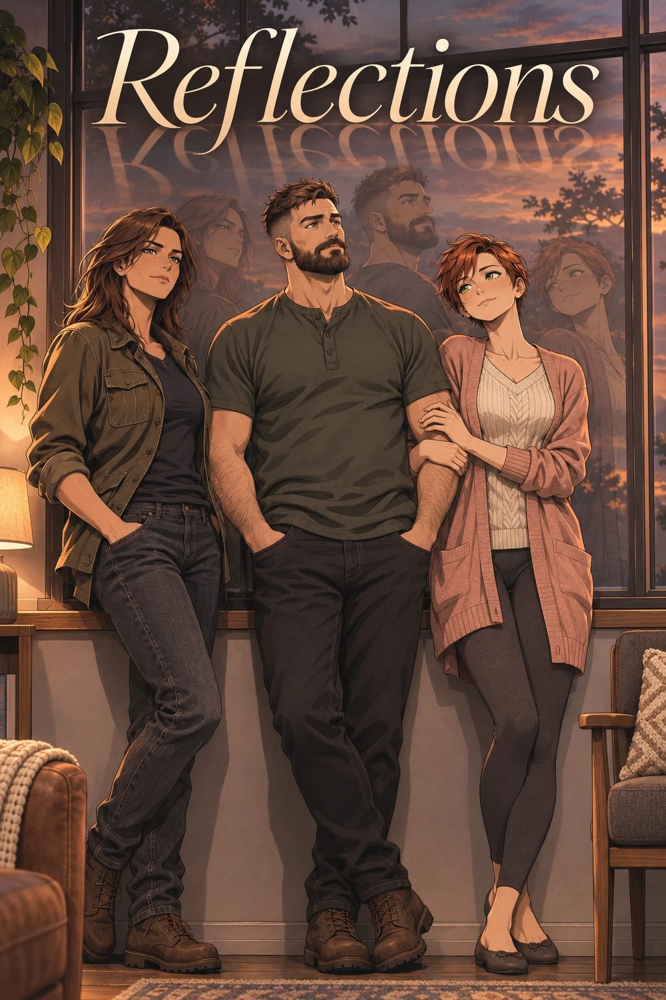</a>

<h1 align="center">Reflections</h1>

<em>How can someone be the person everyone needs, without losing the person they actually are?</em>

  A character-driven manga about one family: three adults in a committed marriage, three kids, 
  and the quiet work of being truly known by the people you love.

  <a href="https://reflections-manga.vercel.app/series"><strong>📖 Read the series</strong></a> &nbsp;·&nbsp;
  <a href="https://reflections-manga.vercel.app/characters"><strong>👥 Meet the characters</strong></a> &nbsp;·&nbsp;
  <a href="https://reflections-manga.vercel.app/memories"><strong>📸 Open the photo album</strong></a>

---

## 💞 The three at the heart of it

Ethan, Morgan and Ruby share one home and one marriage. Ethan is married to both women; Morgan and Ruby are best friends and co-parents, not a couple.

<table>
  <tr>
    <td align="center" width="33%" valign="top">
      <a href="characters/main/morgan-hayes/index.md">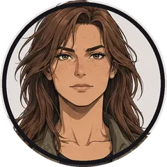</a> 
      <a href="characters/main/morgan-hayes/index.md"><strong>Morgan H. Walker</strong></a> 
      34 · wife &amp; mom 
      <em>Strong-willed, and more tender than she lets on.</em> 
      Confident, practical and fiercely independent, with a dry sense of humor she hides behind more often than she'd admit.
    </td>
    <td align="center" width="33%" valign="top">
      <a href="characters/main/ethan-walker/index.md">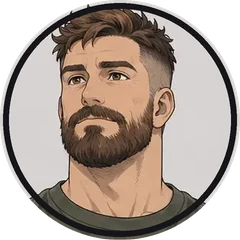</a> 
      <a href="characters/main/ethan-walker/index.md"><strong>Ethan Walker</strong></a> 
      38 · husband &amp; dad 
      <em>The one everyone leans on.</em> 
      A dependable problem solver who keeps his own uncertainty to himself, and would rather crack a joke than admit he's struggling.
    </td>
    <td align="center" width="33%" valign="top">
      <a href="characters/main/ruby-bennett-walker/index.md">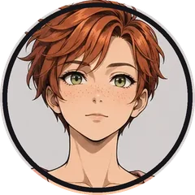</a> 
      <a href="characters/main/ruby-bennett-walker/index.md"><strong>Ruby Bennett-Walker</strong></a> 
      28 · wife &amp; mom 
      <em>The quiet heart of the house.</em> 
      Warm, gentle and quietly romantic. She speaks through attention and small gestures, and moves with a former dancer's grace.
    </td>
  </tr>
</table>

## 🧸 The kids

All three see all three adults as their parents.

<table>
  <tr>
    <td align="center" width="33%" valign="top">
       
      <a href="characters/main/rowan-hayes-walker/index.md"><strong>Rowan Walker</strong></a> 
      9 · 130 cm · Ethan &amp; Morgan's son 
      <em>The builder with a comeback for everything.</em>
    </td>
    <td align="center" width="33%" valign="top">
      <a href="characters/main/riley-hayes-walker/index.md">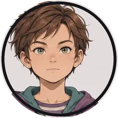</a> 
      <a href="characters/main/riley-hayes-walker/index.md"><strong>Riley Walker</strong></a> 
      About 6 · 110 cm · Ethan &amp; Morgan's daughter 
      <em>Fearless, curious, and doing it herself.</em>
    </td>
    <td align="center" width="33%" valign="top">
      <a href="characters/main/avery-bennett-walker/index.md">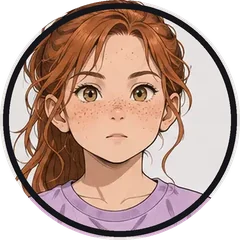</a> 
      <a href="characters/main/avery-bennett-walker/index.md"><strong>Avery Bennett Walker</strong></a> 
      7 · 126 cm · Ethan &amp; Ruby's daughter 
      <em>All motion, music and big feelings.</em>
    </td>
  </tr>
</table>

  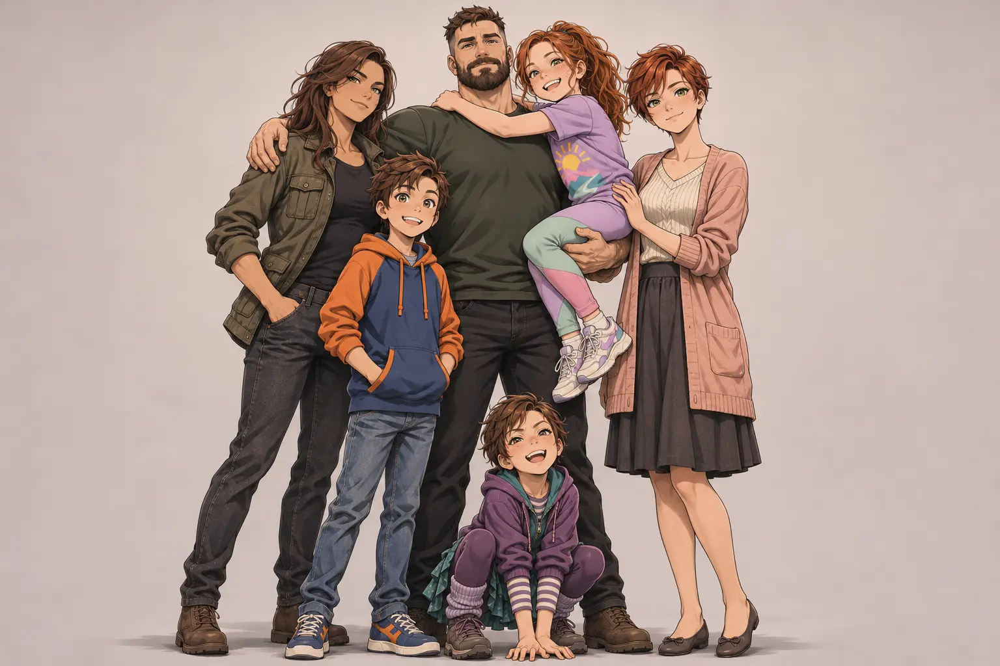
   The family portrait

## 🌳 The family tree

  <a href="https://reflections-manga.vercel.app/characters">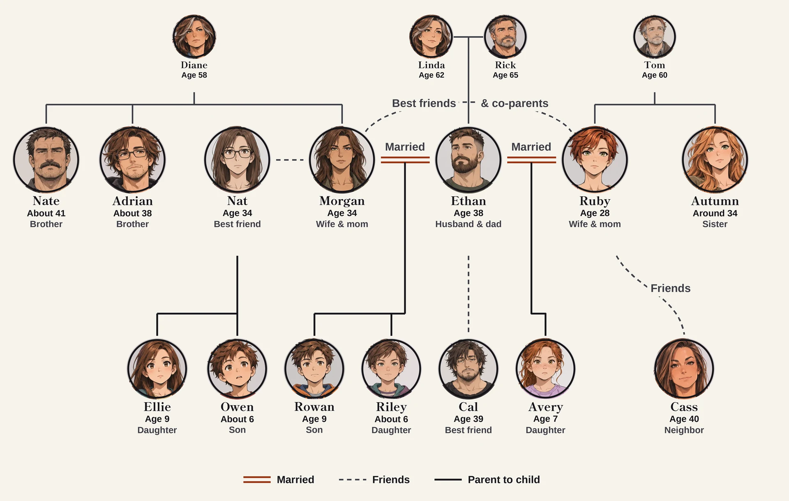</a>

Read the family tree as text

Ethan is married to both Morgan and Ruby; all three married in one shared ceremony. Morgan and Ruby are best friends and co-parents, not a couple. Ethan and Morgan's children are Rowan, 9, and Riley, about 6, who are full siblings. Ethan and Ruby's daughter is Avery, 7, a half-sister to both. Rowan is closest to Ruby, Riley to Morgan, and Avery to Ethan.

Diane Hayes, 58, is mother to Morgan and her two older brothers, Nate, about 41, and Adrian, about 38. Linda Walker, 62, and Richard (Rick) Walker, 65, are Ethan's parents. Thomas (Tom) Bennett, 60, is father to Ruby and Autumn. Nat Greene is Morgan's best friend outside the household and mom to Ellie, 9, and Owen, about 6. Cal Mercer, 39, is Ethan's best friend. Cass Bennett, 40, lives next door and is Ruby's friend; despite the shared surname, she isn't related to Ruby's family.

The full record is in [characters/family-tree.md](characters/family-tree.md).

## 🤝 The people around them

<table>
  <tr>
    <th colspan="3" align="left">🏡 Morgan's family, the Hayes</th>
  </tr>
  <tr>
    <td align="center" valign="top"><a href="characters/family/hayes/diane-hayes/index.md">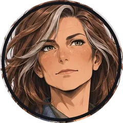</a> <a href="characters/family/hayes/diane-hayes/index.md"><strong>Diane</strong></a> 58 · Morgan's mother</td>
    <td align="center" valign="top"><a href="characters/family/hayes/nathan-hayes/index.md">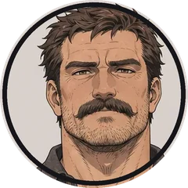</a> <a href="characters/family/hayes/nathan-hayes/index.md"><strong>Nate</strong></a> About 41 · oldest brother</td>
    <td align="center" valign="top"> <a href="characters/family/hayes/adrian-hayes/index.md"><strong>Adrian</strong></a> About 38 · middle brother</td>
  </tr>
  <tr>
    <th colspan="3" align="left">👓 Morgan's best friend, the Greenes</th>
  </tr>
  <tr>
    <td align="center" valign="top"> <a href="characters/friends/natalie-greene/index.md"><strong>Nat</strong></a> 34 · Morgan's best friend</td>
    <td align="center" valign="top"> <a href="characters/friends/ellie-greene/index.md"><strong>Ellie</strong></a> 9 · Nat's daughter</td>
    <td align="center" valign="top"> <a href="characters/friends/owen-greene/index.md"><strong>Owen</strong></a> About 6 · Nat's son</td>
  </tr>
  <tr>
    <th colspan="3" align="left">🏍️ Ethan's family and best friend</th>
  </tr>
  <tr>
    <td align="center" valign="top"> <a href="characters/family/walker/linda-walker/index.md"><strong>Linda</strong></a> 62 · Ethan's mother</td>
    <td align="center" valign="top"><a href="characters/family/walker/richard-walker/index.md">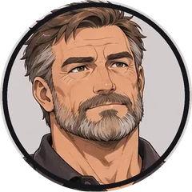</a> <a href="characters/family/walker/richard-walker/index.md"><strong>Rick</strong></a> 65 · Ethan's father</td>
    <td align="center" valign="top"><a href="characters/friends/caleb-mercer/index.md">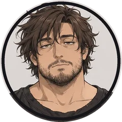</a> <a href="characters/friends/caleb-mercer/index.md"><strong>Cal</strong></a> 39 · Ethan's best friend</td>
  </tr>
  <tr>
    <th colspan="3" align="left">🌻 Ruby's family, the Bennetts, and her neighbor</th>
  </tr>
  <tr>
    <td align="center" valign="top"><a href="characters/family/bennett/thomas-bennett/index.md">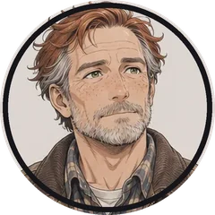</a> <a href="characters/family/bennett/thomas-bennett/index.md"><strong>Tom</strong></a> 60 · Ruby and Autumn's father</td>
    <td align="center" valign="top"> <a href="characters/family/bennett/autumn-bennett/index.md"><strong>Autumn</strong></a> Around 34 · Ruby's big sister</td>
    <td align="center" valign="top"> <a href="characters/friends/cassidy-bennett/index.md"><strong>Cass</strong></a> 40 · Ruby's friend next door (no relation)</td>
  </tr>
</table>

Nate and Adrian's ages and backstory are still drafts; see the [Hayes family history](characters/hayes-family-history.md).

## 📸 From the album

<table>
  <tr>
    <td width="33%">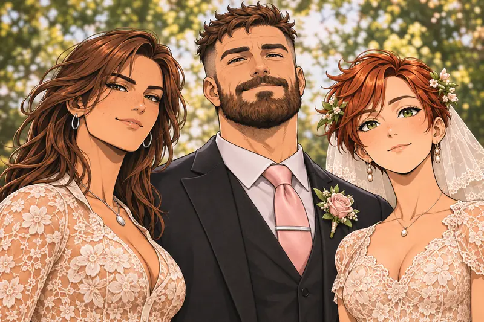 Wedding day</td>
    <td width="33%">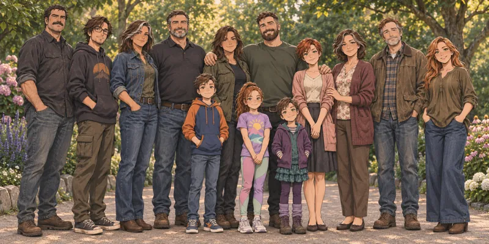 The whole family</td>
    <td width="33%"> The ride</td>
  </tr>
  <tr>
    <td>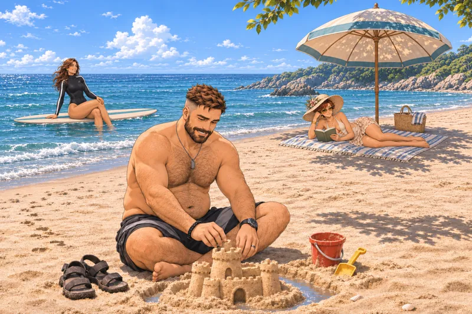 Beach day</td>
    <td>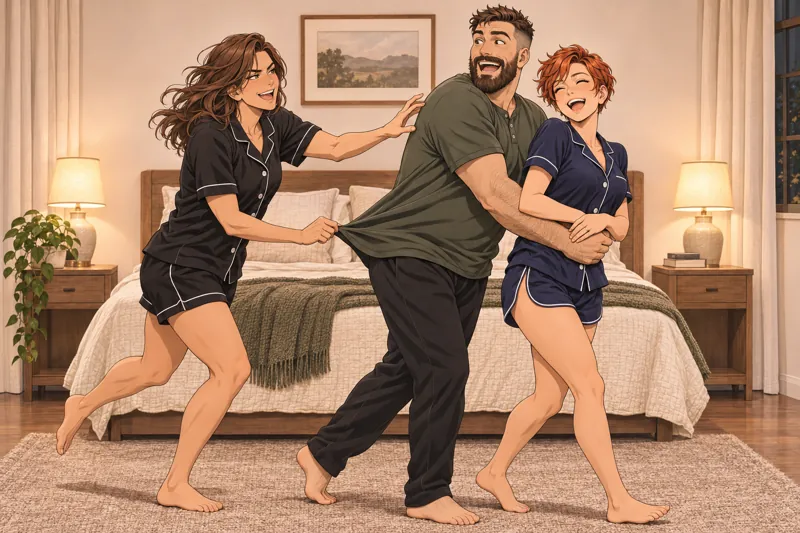 Pajama chase</td>
    <td> Girls' trip</td>
  </tr>
</table>

<a href="https://reflections-manga.vercel.app/memories">See every page of the album →</a>

## 🗺️ The road ahead

Fifteen connected stories in four arcs. Story outlines are in development and may change.

<table>
  <tr>
    <td align="center" width="25%" valign="top">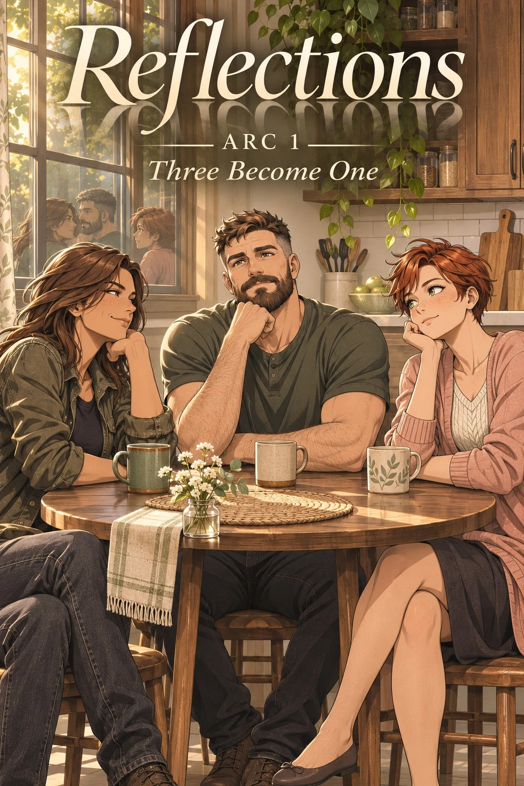 <strong>I · Three Become One</strong> The marriage, the personalities, the affection, and the needs no one has said out loud.</td>
    <td align="center" width="25%" valign="top">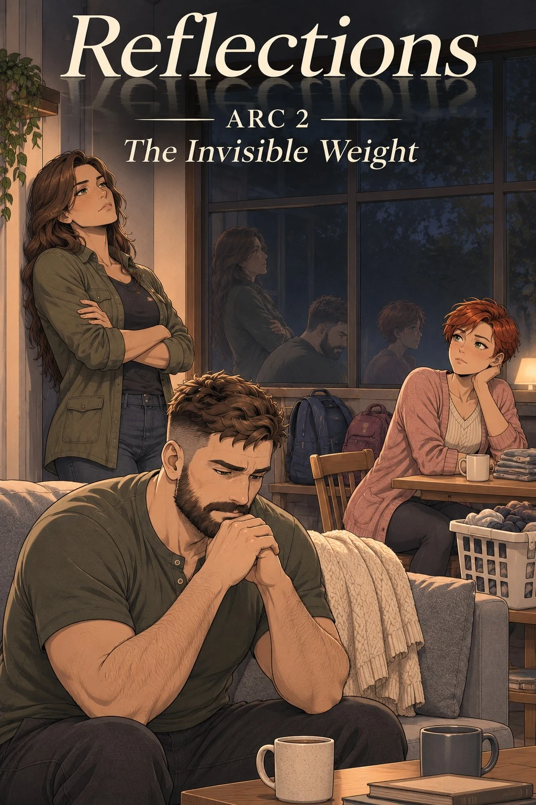 <strong>II · The Invisible Weight</strong> Parenthood, exhaustion, communication and loneliness.</td>
    <td align="center" width="25%" valign="top">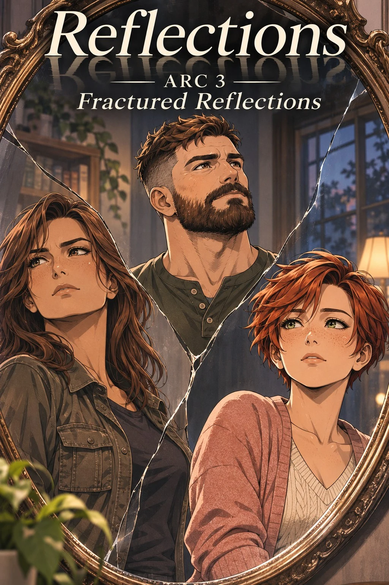 <strong>III · Fractured Reflections</strong> Past damage, intimacy, boundaries and personal identity.</td>
    <td align="center" width="25%" valign="top">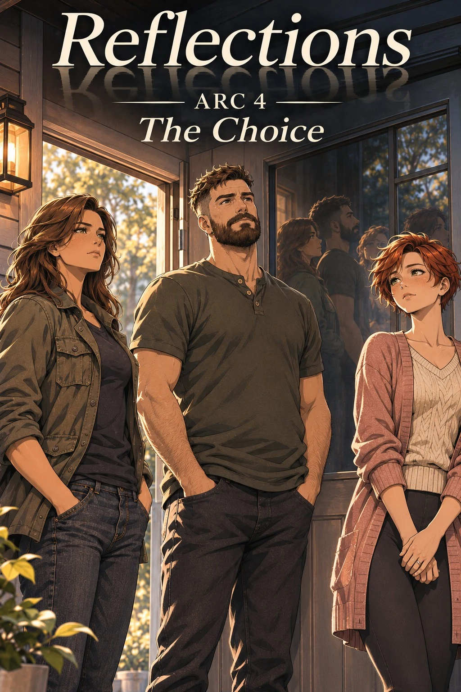 <strong>IV · The Choice</strong> The future of the family, and whether all three choose to continue together.</td>
  </tr>
</table>

See the [series roadmap](series/roadmap.md). All characters and events are fictional.

---

## 🛠️ Behind the scenes

<strong>Project structure</strong>

- `series/`: Series bible, art direction, production rules
- `characters/`: Canonical character profiles and design references
- `stories/`: Story arcs, chapters, scripts, and storyboards
- `world/`: Fictional locations, props, and worldbuilding
- `assets/`: Approved reusable artwork and visual references (README art lives in `assets/readme/`; rebuild it with `assets/readme/build.py`)
- `continuity/`: Canon decisions, relationships, timeline, arc planning, and unresolved threads
- `production/`: Planning, reviews, and releases
- `prompts/`: Stage-by-stage production prompts, panel templates, and character-prompt index
- `sources/`: Local-only, unpublished source development
- `site/`: The public website and the private Reflections Studio (see [site/README.md](site/README.md))

<strong>Workflow</strong>

The series has a [15-story connected roadmap](series/roadmap.md), grouped
into four arcs. These are future development plans, not separate continuities
or approved chapter events. Begin with Three Hearts, Different Needs.

1. Develop story concepts.
2. Write chapter outlines and scripts.
3. Prepare storyboards and panel descriptions.
4. Generate character-consistent artwork.
5. Review continuity.
6. Approve finished pages.
7. Update the canon and chapter registry.
8. Commit approved completed story files and push to the configured GitHub remote.

Keep project files current during each working session. See the
[family tree](characters/family-tree.md), [approved names](characters/name-options.md),
and [relationship canon](continuity/relationships.md) for current family development.
See the [relative timeline](continuity/timeline.md) for established history and
[character arc planning](continuity/character-arcs.md) for unapproved development questions.
Start with the [production walkthrough](production/getting-started.md) and
[stage-by-stage prompt library](prompts/index.md). The library also links all
seventeen character reference-sheet prompts.

<strong>Reflections Studio</strong>

A private studio at `/admin` on the site generates chapter pages from the
prompts and character sheets in this repository with OpenAI, checks them, and
publishes approved pages through a pull request. Locked pages and canonical
files are never overwritten. See [docs/studio](docs/studio/SETUP.md) and
[production/studio](production/studio/README.md).

<strong>Canon rules and approval notes</strong>

Approved reference images and canonical profiles take precedence
over experimental prompts or generated variations.
Changes must be recorded in `continuity/change-log.md`.

- Children: written appearance, personality, and wardrobe selections are approved.
  See the [approved questionnaire answers](characters/questionnaire-answers.md).
- Parent generation: written parent profiles and current names approved 2026-11-13.
  Hayes is Morgan's middle name and Walker her surname. Avery Bennett Walker remains
  unhyphenated. Existing folders and image paths are stable legacy identifiers.
- Childhood family history approved 2026-11-13: Morgan's father had alcoholism
  and left the family when she was 13; Ruby's mother died when she was 6.
  See the [family chronology](continuity/timeline.md#childhood-family-history-approved-2026-11-13)
  for timing limits and unresolved details.
- Supporting cast: selected character direction and provisional suggestions are labeled separately.
  Seven supporting-character reference-sheet prompts are linked from their
  profiles, including Ellie, Owen, Nate, and Adrian. Nate and Adrian's prompts
  are design studies only; neither has a registered reference image or approved
  model sheet. Their proposed ages, 41 and 38, and detailed backstory remain drafts.

<strong>Status</strong>

- Project setup: Family and written child specifications established
- Character profiles: Seventeen profiles; four parent written profiles and central-family child questionnaire choices approved; Hayes sibling details, other adult visual drafts, and supporting-child designs awaiting approval
- Artwork: Six user-saved character cards registered for reuse; no new chapter artwork generated
- Chapters released: 0

See [production status](production/status.md) for remaining work and open decisions.

