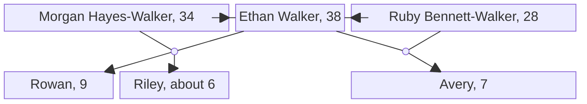

# Family Tree

Status: Parentage, names, Rowan's age of 9, and Avery's age of 7 approved.
Riley remains approximately 6. Heights approved: Rowan 130 cm, Riley 110 cm, Avery 126 cm.

The top row shows Morgan on the left, Ethan in the middle, and Ruby on the right.
Arrows from Ethan to each woman indicate their romantic relationships.
Each small circle joins two parents' lines; arrows below it lead to their children.
Morgan's children use Hayes-Walker; Ruby's daughter uses Bennett-Walker.
All three adults share a marital commitment. Morgan and Ruby are platonic.
They married in one shared ceremony, with Ethan between the two women; the
diagram's left/right layout does not establish ceremony sides. Legal recognition
remains unspecified.

| Sibling pair | Parentage |
|---|---|
| Rowan and Riley | Full siblings, Ethan and Morgan |
| Rowan and Avery | Paternal half-siblings, shared father Ethan |
| Avery and Riley | Paternal half-siblings, shared father Ethan |

## Shared Parenting and Bonds

The diagram and sibling terms preserve existing parentage records. All three
children recognize all three adults as parents and both women as their mothers.
Parentage lines do not limit caregiving or indicate which bonds are strongest.

| Child | Closest parental attachment |
|---|---|
| Avery | Ethan |
| Rowan | Ruby |
| Riley | Morgan |

Rowan and Riley are nearly inseparable. Avery sometimes ends up outside their
close pairing, but all three still enjoy playing together.

Ruby handles most daily care for all three children. Morgan works part-time
and is the firmer disciplinary mother; Ethan works full-time. The user's
suggested preferred mother-address forms are Mom for Morgan and Mommy for Ruby.

## Extended Family and Friends

Supporting-cast relationships selected 2026-11-13:

| Connection | Established relationship | Limits |
|---|---|---|
| [Autumn](autumn/index.md) and Ruby | Autumn is Ruby's older sister and Avery's aunt through Ruby | Surname, exact age, sibling type, and family history remain open |
| [Natalie "Nat" Greene](natalie-greene/index.md), [Ellie](ellie-greene/index.md), and [Owen](owen-greene/index.md) | Nat is their mother; Ellie is 9, Owen approximately 6 | Other parentage, full/half/adoptive sibling status, custody, and household remain open |
| [Caleb "Cal" Mercer](caleb-mercer/index.md) and Ethan | Best friends | Meeting, duration, and shared history remain open |
| Nat and Morgan | Best friends outside the shared household | Morgan and Ruby's best-friend/coparent bond is also preserved |

These connections add no parenting or residence lines to the central household.
Ellie matches Rowan's age; Owen matches Riley's approximate age. Equal ages do
not establish shared schools or existing friendships. Autumn's surname remains
unestablished despite Ruby's current Bennett-Walker name.

## Approximate Parent Ages at Birth

| Child | Ethan | Mother |
|---|---:|---|
| Rowan, 9 | 29 | Morgan, 25 |
| Avery, 7 | 31 | Ruby, 21 |
| Riley, 6 | 32 | Morgan, 28 |

Birthdays, marriage dates, and relationship start dates remain unestablished.
These calculations do not establish when the shared marriage began.

See [relationships](../continuity/relationships.md) and
[timeline](../continuity/timeline.md) for history, boundaries, and open details.
