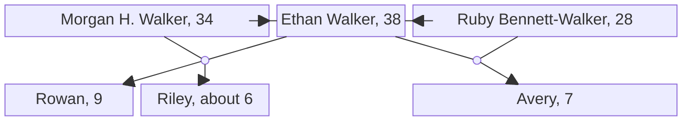
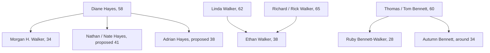

# Family Tree

Status: Parentage, names, Rowan's age of 9, and Avery's age of 7 approved.
Riley remains approximately 6. Heights approved: Rowan 130 cm, Riley 110 cm, Avery 126 cm.

The top row shows Morgan on the left, Ethan in the middle, and Ruby on the right.
Arrows from Ethan to each woman indicate their romantic relationships.
Each small circle joins two parents' lines; arrows below it lead to their children.
Morgan's children are Rowan Walker and Riley Walker. Ruby's daughter is Avery
Bennett Walker, without a hyphen; her mother remains Ruby Bennett-Walker.
Morgan uses Hayes as her middle name and Walker as her surname, displayed Morgan H. Walker.
All three adults share a marital commitment. Morgan and Ruby are platonic.
They married in one shared ceremony, with Ethan between the two women; the
diagram's left/right layout does not establish ceremony sides. Legal recognition
remains unspecified.

| Sibling pair | Parentage |
|---|---|
| Rowan and Riley | Full siblings, Ethan and Morgan |
| Rowan and Avery | Paternal half-siblings, shared father Ethan |
| Avery and Riley | Paternal half-siblings, shared father Ethan |

## Shared Parenting and Bonds

The diagram and sibling terms preserve existing parentage records. All three
children recognize all three adults as parents and both women as their mothers.
Parentage lines do not limit caregiving or indicate which bonds are strongest.

| Child | Closest parental attachment |
|---|---|
| Avery | Ethan |
| Rowan | Ruby |
| Riley | Morgan |

Rowan and Riley are nearly inseparable. Avery sometimes ends up outside their
close pairing, but all three still enjoy playing together.

Ruby handles most daily care for all three children. Morgan works part-time
and is the firmer disciplinary mother; Ethan works full-time. The user's
suggested preferred mother-address forms are Mom for Morgan and Mommy for Ruby.

## Approved Parent Generation

Written profiles and these parent connections approved 2026-11-13.

Diane is Rowan and Riley's grandmother through Morgan; Tom is Avery's
grandfather through Ruby. Rick and Linda are grandparents to all three
children through Ethan. These lines establish parentage, not residence,
marital status, caregiving duties, or emotional closeness.

Nate and Adrian were added 2026-11-13 as Morgan's older brothers and Diane's
sons: Nate oldest, Adrian middle, Morgan youngest. They share the unnamed
father in Morgan's established history. Nate and Adrian are uncles through
Morgan to Rowan and Riley. Their diagram ages are proposals, not approved ages;
see the [Hayes family-history record](hayes-family-history.md) for approval limits.

Family history approved 2026-11-13:

- Morgan's father had alcoholism and left the family when Morgan was 13.
  Diane raised Morgan without him after his departure. His name, current
  status, and later contact remain unspecified.
- Ruby's mother died when Ruby was 6. Tom raised Ruby without her afterward.
  Her name and cause of death remain unspecified.
- Tom also raised Autumn without her mother present. The sisters' shared
  father does not establish a shared mother; Autumn's maternal history stays open.

See the [childhood chronology](../continuity/timeline.md#childhood-family-history-approved-2026-11-13)
for approximate offsets from the opening snapshot. No divorce or additional
circumstances for those absent parents are established.

## Extended Family and Friends

Supporting-cast relationships selected 2026-11-13:

| Connection | Established relationship | Limits |
|---|---|---|
| [Nate](family/hayes/nathan-hayes/index.md), [Adrian](family/hayes/adrian-hayes/index.md), and Morgan | Hayes siblings, all Diane's children; Nate oldest, Morgan youngest | Brothers' ages, childhood responses, designs, jobs, and current family circumstances are proposals |
| [Autumn Bennett](family/bennett/autumn-bennett/index.md) and Ruby | Autumn is Ruby's older sister and Avery's aunt through Ruby | Exact age, sibling type, and family history remain open |
| [Natalie "Nat" Greene](friends/natalie-greene/index.md), [Ellie](friends/ellie-greene/index.md), and [Owen](friends/owen-greene/index.md) | Nat is their mother; Ellie is 9, Owen approximately 6 | Other parentage, full/half/adoptive sibling status, custody, and household remain open |
| [Caleb "Cal" Mercer](friends/caleb-mercer/index.md) and Ethan | Best friends | Meeting, duration, and shared history remain open |
| Nat and Morgan | Best friends outside the shared household | Morgan and Ruby's best-friend/coparent bond is also preserved |

These supporting friends and sibling connections add no new parenting or
residence lines to the central household. Grandparent lines are recorded above.
Ellie matches Rowan's age; Owen matches Riley's approximate age. Equal ages do
not establish shared schools or existing friendships. The user confirmed the
names Autumn Bennett and Ruby Bennett-Walker on 2026-11-13. Avery's revised name is Avery Bennett Walker, approved 2026-11-13.

## Approximate Parent Ages at Birth

| Child | Ethan | Mother |
|---|---:|---|
| Rowan, 9 | 29 | Morgan, 25 |
| Avery, 7 | 31 | Ruby, 21 |
| Riley, 6 | 32 | Morgan, 28 |

Birthdays, marriage dates, and relationship start dates remain unestablished.
These calculations do not establish when the shared marriage began.

See [relationships](../continuity/relationships.md) and
[timeline](../continuity/timeline.md) for history, boundaries, and open details.

## Neighbor Surname Boundary: 2026-11-19

[Cassidy "Cass" Bennett](friends/cassidy-bennett/index.md) is the Australian next-door
neighbor, not an established member of Ruby's family tree. She is a mother;
her household and relatives remain undecided. Shared Bennett surnames establish
no parent, sibling, cousin, aunt, or other family connection.
